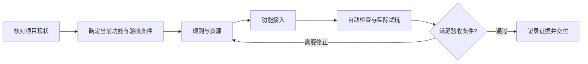

# Game Development Workflow

### 把游戏开发中的规则、素材、代码和验证，推进到同一个可玩版本。

**一个入口 Skill · 12 个开发环节 · 10 份阶段说明 · Codex / Claude Code**

为使用 AI 编程助手开发游戏的人提供一套可安装的工作流。新项目从需求开始，已有项目从当前缺口继续，每个功能都完成“规则 → 资源 → 实现 → 实战 → 交付”的闭环。

[快速开始](#快速开始) · [工作方式](#工作方式) · [开发环节](#开发环节) · [使用示例](#使用示例) · [仓库结构](#仓库结构)

## 为什么需要这套工作流

用 AI 做游戏时，一个功能往往分散在多轮对话里：规则确认过了，代码却用了另一套数值；角色图已经生成，实际出战仍在用旧素材；自动测试通过了，进化、奖励或续战流程却没有完整玩过。

这套工作流把这些环节放进同一份待办，为每个阶段定义产物和通过条件：

- **接着已有工作推进**：先读项目规则、代码和待办，识别真实缺口，保留已确认设计与明确延期项。
- **围绕完整功能组织工作**：素材制作后继续接入，接入后继续验证，避免各环节脱节。
- **让完成状态可以核对**：分别记录已制作、已接入、自动验证、实战和真机结果。
- **让决策与执行各有边界**：已授权事项持续推进，重大玩法和永久经济调整先形成方案再确认。

## 安装后获得什么

| 内容 | 用途 |
| --- | --- |
| `game-production-flow` 入口 Skill | 判断当前阶段，路由到本次任务需要的说明 |
| 12 环节工作流 | 定义需求、制作、接入、验证和交付各阶段的产物与验收门 |
| 10 份阶段说明 | 覆盖数值、关卡、界面、美术、手感、运行接入、存档、验收和性能 |
| 3 份记录模板 | 维护统一任务卡、素材记录和验收证据 |
| Markdown / JSON / HTML 概览 | 供开发者阅读、助手读取和浏览工作流 |

安装内容包含上述说明与模板。图像生成、浏览器、游戏引擎及构建工具由你使用的助手环境提供。

## 快速开始

需要 Node.js 和支持 Skills 的 AI 编程助手。以下命令通过 Skills CLI 安装，无需单独发布或安装本仓库的 npm 包。

在游戏项目目录中，为 **Codex** 安装：

```bash
npx skills add Tangchen2016/game-dev-workflow --skill game-production-flow -a codex
```

为 **Claude Code** 安装：

```bash
npx skills add Tangchen2016/game-dev-workflow --skill game-production-flow -a claude-code
```

默认安装到当前项目；需要跨项目使用时，在命令末尾加 `-g`。安装时核对目标位置及同名 Skill 的覆盖提示。

安装后，在对应助手中发送：

```text
使用 game-production-flow，检查当前游戏的规则、代码、素材和待办，
判断目前完成到哪一步，从未完成且已授权的事项继续推进。
每个功能完成制作、接入和验证后，再进入下一项。
```

## 工作方式

入口 Skill 先读取项目的 `AGENTS.md`、现有待办、已确认规则和真实运行入口，再从 [workflow.json](workflow.json) 选择适用环节，按需读取阶段说明。



**以一个完整功能为一个批次。** 例如做伙伴进化：从选择、出战、技能触发，一直推进到碎片消耗、进化结果和存档恢复。每一步更新同一份待办，保留验证结果。

| 状态 | 含义 |
| --- | --- |
| 已制作 | 规则、素材或代码已经产出 |
| 已接入 | 实际运行路径已经使用这些产物 |
| 已自动验证 | 对应检查、模拟或测试通过 |
| 已实战验证 | 启动游戏并实际操作了相关流程 |
| 待真机 / 已真机验证 | 明确目标设备上的验证状态 |
| 已交付 | 交付文件与验收通过的运行版本一致 |

有阻塞时记录原因，继续不依赖它的已授权事项；用户明确延期的内容保留延期。新消息默认补充当前任务，已有项目也不需要从第一个阶段重新开始。

## 开发环节

12 个环节按任务需要进入，不要求每次从头执行。每个环节都有产物和通过条件，完整定义见 [WORKFLOW.md](WORKFLOW.md)。

| 环节 | 主要产物 |
| --- | --- |
| 01 · 需求与范围 | 需求清单、统一待办、验收条件 |
| 02 · 玩法与经济 | 规则与参数、资源产消表 |
| 03 · 关卡与节奏 | 波次、敌群、首领、教学和难度曲线 |
| 04 · 界面与视觉规范 | 页面流程、设计图、尺寸与品质规范 |
| 05 · 角色与素材 | 角色与品质素材、提示词、资源索引 |
| 06 · 动作与手感 | 状态动作、投射物、命中特效、反馈音效 |
| 07 · 功能接入 | 使用正式规则和素材的可操作版本 |
| 08 · 存档与奖励 | 存档迁移、奖励幂等、冲突与续战验证 |
| 09 · 数值与回归 | 多配置模拟、数值分析、回归报告 |
| 10 · 视觉与完整实战 | 真实操作、截图或录像、缺陷记录 |
| 11 · 移动端与性能 | 视口适配、真机检查、性能报告 |
| 12 · 整理与交付 | 文档、素材索引、运行包、哈希报告 |

## 使用示例

**新项目：先明确范围。**

```text
使用 game-production-flow，帮我启动一个竖屏守城游戏。
先整理核心循环、最小可玩范围和验收条件，玩法与技术栈确认后再实现。
```

**已有项目：完成一个功能。**

```text
使用 game-production-flow，继续当前游戏的伙伴进化功能。
沿用已确认规则和界面，检查素材、技能触发、奖励和存档恢复，
完成接入后验证实际出战与进化流程。
```

**交付前：核对完成证据。**

```text
使用 game-production-flow，检查当前版本是否满足已有验收条件。
列出已验证、待实战、待真机、阻塞和延期事项，附上对应证据。
先完成检查，不执行发布。
```

## 仓库结构

```text
.
├── README.md                         # 安装与使用指南
├── WORKFLOW.md                       # 12 个环节、产物与验收门
├── workflow.json                     # 工作流结构化定义
├── index.html                        # 工作流概览页面
├── SOURCES.json                      # 内置参考来源与快照校验值
└── skills/game-production-flow/
    ├── SKILL.md                      # 唯一安装入口
    └── references/
        ├── workflow.md
        ├── workflow.json
        ├── skills/                   # 10 份按需读取的阶段说明
        └── templates/                # 任务卡、素材记录、验收模板
```

阶段说明覆盖玩法数值、关卡设计、界面、美术生成、动作手感、运行接入、存档安全、验收交付及性能检查。其中 `tower-defense` 仅在游戏类型适用时使用。

任务模板：[任务卡](skills/game-production-flow/references/templates/task-card.md) · [素材记录](skills/game-production-flow/references/templates/asset-record.json) · [验收记录](skills/game-production-flow/references/templates/acceptance.md)

## 更新与移除

```bash
# 查看项目中安装的 Skills
npx skills list

# 更新项目中的工作流
npx skills update game-production-flow -p

# 更新全局安装的工作流
npx skills update game-production-flow -g

# 移除入口 Skill
npx skills remove game-production-flow
```

全局安装的查看与移除命令分别为 `npx skills list -g` 和 `npx skills remove game-production-flow -g`。其他选项以 `npx skills --help` 为准。

也可以克隆仓库后，从本地路径安装：

```bash
git clone https://github.com/Tangchen2016/game-dev-workflow.git
cd <你的游戏项目目录>
npx skills add <仓库的绝对路径> --skill game-production-flow -a codex
```

## 工具与使用边界

- 本仓库提供工作规程、参考说明和模板。图像生成、浏览器操作、音频、游戏引擎及平台构建能力需要运行环境另行提供。
- 沿用项目现有技术栈、已确认玩法和设计。局部修改按现有规范处理；重大玩法与永久经济变更先形成方案再确认。
- 生成素材后仍需检查透明度、裁切、动作帧一致性和运行效果；通过模拟或自动测试后，仍需按验收要求完成实战及真机检查。
- 工作流本身不自动安装额外依赖或启动子代理，也不赋予发布、支付、广告和账号操作权限。

## 来源与授权

部分阶段说明来自本地 Skill 快照，来源类别及入口文件 SHA-256 记录在 [SOURCES.json](SOURCES.json)，不代表持续同步上游版本。

第三方内容保留各自授权；随附的 ImageGen 授权见 [LICENSE.txt](skills/game-production-flow/references/skills/imagegen/LICENSE.txt)。本仓库未统一声明为 MIT，其他快照的上游授权信息尚待补齐；再次分发或用于其他发布物前，请逐项核对。
